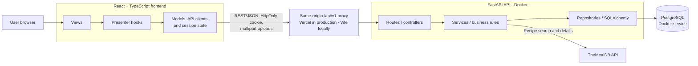

# Cart to Kitchen

Cart to Kitchen is a full-stack cooking planner that connects grocery shopping,
inventory management, recipe discovery, guided cooking, and cooking history in
one application. Users can register or continue as a guest, shop in a 2D or 3D
store, place owned ingredients on a kitchen counter, discover real recipes from
TheMealDB, complete a dish, and save a formatted review with an optional image.

This repository is the DH2643 Group 5 project.

## Team members and responsibilities


| Team member | Area | Primary contributions |
| --- | --- | --- |
| **Jintong Jiang** | Store/Kitchen and integration | Established the frontend skeleton and design system; developed the 2D/3D store, first-person navigation, ingredient models, store interactions, cart animation, and Store/backend integration; implemented the drag-and-drop Kitchen and connected the Kitchen, recipe discovery, cooking, and finished-dish flows; contributed profile styling and refactoring. |
| **Emma Lindblom** | Profile and testing | Developed the Profile experience including; reusable dialogs, account settings, history, avatar upload, and review with TipTap rich-text editing. Also implemented profile frontend to backend integration, validation, and error feedback. Finally set up Cypress and added the majority of component tests across frontend. |
| **Lexuan Zhang** | Backend | Implemented the FastAPI backend and its core server-side functionality, including persistence and API support for the frontend flows; maintained backend architecture documentation and synchronized the architecture diagrams with the Kitchen and recipe-discovery implementation. |

## Project status

- The frontend and backend run locally as an integrated application.
- PostgreSQL and the FastAPI server run locally with Docker Compose.
- The frontend runs with Vite and proxies `/api/v1` to the local API.
- The public frontend is deployed on Vercel at <https://cart-to-kitchen.vercel.app/>.
- The FastAPI and PostgreSQL Docker Compose stack is deployed on a public host;
  its health check is <http://159.195.240.39:8000/healthz>.

## Core user journey

1. Register, sign in, or continue as a guest.
2. Browse the 3D store or switch to the 2D catalogue.
3. Add ingredients to the cart and complete checkout within the wallet balance.
4. Drag purchased or pantry ingredients onto the kitchen counter.
5. Find dishes, inspect recipe details, and add owned missing ingredients.
6. Follow the cooking steps and finish the recipe once.
7. Open the profile to review cooking history, update account information, and save formatted reviews and images.

## Main features

- Account registration, login, logout, guest sessions, and HttpOnly cookie authentication.
- A persistent wallet, cart, inventory, cooking history, profile, avatar, and reviews stored through the server in PostgreSQL.
- An interactive 3D grocery store with 80 sellable ingredients, a 2D fallback catalogue, cart management, wallet validation, and checkout.
- A drag-and-drop kitchen counter with 30 unlimited pantry ingredients.
- Server-backed recipe search and discovery using TheMealDB, with local classification into ready, almost ready, and shopping-required groups.
- Guided cooking, retry-safe completion through an idempotency key, and history-based finished-dish pages.
- Profile editing, image upload, and a TipTap review editor with bold, italic, and underline controls. Reviews are limited to 1,500 visible characters.
- Loading, error, retry, disabled, toast, and success states for asynchronous actions.

## Architecture



The frontend follows a feature-based Model-View-Presenter structure: views
render state and forward user actions, presenter hooks coordinate screen
behaviour, and model modules own API access, types, stores, and business rules.
In production, Vercel serves the static frontend and rewrites same-origin
`/api/v1` requests to the public API. Vite provides the equivalent proxy during
local development.

The backend separates HTTP routes, business services, repositories, SQLAlchemy
models, and external integrations. Repositories are the only layer that accesses
PostgreSQL, while services coordinate TheMealDB calls and domain rules. The
browser never connects directly to either PostgreSQL or TheMealDB.

See [frontend/README.md](frontend/README.md),
[backend/README.md](backend/README.md), and
[backend/docs/ARCHITECTURE.md](backend/docs/ARCHITECTURE.md) for details.

## Repository structure

```text
.
├── frontend/                                     # React, TypeScript, Vite, Cypress, and 3D assets
│   ├── src/                                      # Application source
│   │   ├── app/                                  # Router, providers, routes, and global styles
│   │   ├── features/                             # Feature-based MVP modules
│   │   │   ├── auth/
│   │   │   ├── cooking/
│   │   │   ├── kitchen/
│   │   │   ├── profile/
│   │   │   ├── recipes/
│   │   │   └── store/
│   │   └── shared/                               # Session/API infrastructure and reusable UI
│   ├── public/
│   │   └── models/ingredients/model_web/         # Optimized GLB ingredient assets
│   ├── cypress/                                  # Cypress component-test support
│   ├── tests/                                    # Node integration and model tests
│   ├── quality/                                  # Source-quality checks
│   ├── vercel.json                               # Production API rewrite
│   └── package.json                              # Frontend commands and dependencies
├── backend/                                      # FastAPI, SQLAlchemy, PostgreSQL, pytest, and Postman
│   ├── app/                                      # Backend application source
│   │   ├── api/                                  # HTTP routes and dependencies
│   │   ├── services/                             # Business logic
│   │   ├── data/                                 # SQLAlchemy models and repositories
│   │   └── integrations/                         # External API clients
│   ├── postman/                                  # API collection and local environment
│   ├── scripts/                                  # Catalogue and coverage audits
│   ├── tests/                                    # pytest suite
│   ├── Dockerfile
│   ├── compose.yaml                              # API and PostgreSQL services
│   └── pyproject.toml                            # Python package and test configuration
└── README.md                                     # Project overview and setup
```

Each frontend feature separates `model/`, `presenter/`, and `view/` concerns
where applicable. Cypress component specs live beside the views they exercise;
deterministic Node integration and model tests live in `frontend/tests/`.

## Prerequisites

- Docker Desktop or another Docker installation with Compose support.
- Node.js 22.13 or newer and npm.
- Python 3.11 or newer only when running the backend outside Docker.

## Quick start

### 1. Start PostgreSQL and the backend

From the repository root:

```bash
docker compose -f backend/compose.yaml up --build
```

Wait until both services are healthy. Then verify the API:

```bash
curl http://127.0.0.1:8000/healthz
```

The API documentation is available at <http://127.0.0.1:8000/docs>.

### 2. Start the frontend

In a second terminal:

```bash
cd frontend
npm ci
npm run dev
```

Open <http://localhost:5173>. The default Vite configuration proxies
`/api/v1` to `http://127.0.0.1:8000`, so no frontend environment file is needed
for this setup.

### 3. Stop the local stack

```bash
docker compose -f backend/compose.yaml down
```

To also remove the local PostgreSQL volume and all local application data:

```bash
docker compose -f backend/compose.yaml down -v
```

## Configuration

The backend reads `CTK_` environment variables. Docker Compose supplies safe
local defaults; production deployments must replace the JWT secret and database
password.

| Variable | Default or example | Purpose |
| --- | --- | --- |
| `CTK_DATABASE_URL` | Local PostgreSQL URL | SQLAlchemy database connection |
| `CTK_JWT_SECRET` | Development-only value | JWT signing secret |
| `CTK_ALLOWED_ORIGINS` | Local Vite origins | Credentialed CORS allow-list |
| `CTK_SESSION_HOURS` | `168` | Session lifetime |
| `CTK_PG_PASSWORD` | `ctk-local-only` in Compose | Local PostgreSQL password |
| `VITE_API_BASE_URL` | `/api/v1` through the Vite proxy | Optional direct API base URL |

When `VITE_API_BASE_URL` is used, keep the frontend and backend hostnames
consistent and add the exact frontend origin to `CTK_ALLOWED_ORIGINS`.

## Testing and quality checks

Run frontend commands from `frontend/`:

```bash
npm run lint
npm run build
npm run test:components
npm run test:store
npm run test:kitchen
npm run test:api
```

The current Cypress component suite contains 15 specs and 53 tests covering
the kitchen components, responsive layouts, drag-and-drop behaviour,
profile panels and dialogs, retry behaviour, StepLyrics, and ingredient
card. Components test can also be visually executed with `npx cypress open`

The real HTTP integration test creates accounts, carts, and purchases. Run it
only against a disposable local database:

```bash
CTK_TEST_API_URL=http://127.0.0.1:8000/api/v1 npm run test:backend
```

Run backend commands from `backend/` after installing the development extras:

```bash
python3 -m venv .venv
source .venv/bin/activate
pip install -e ".[dev]"
pytest
```

Run the Postman collection against a running local stack:

```bash
npx newman run backend/postman/cart-to-kitchen.postman_collection.json \
  -e backend/postman/local.postman_environment.json
```

